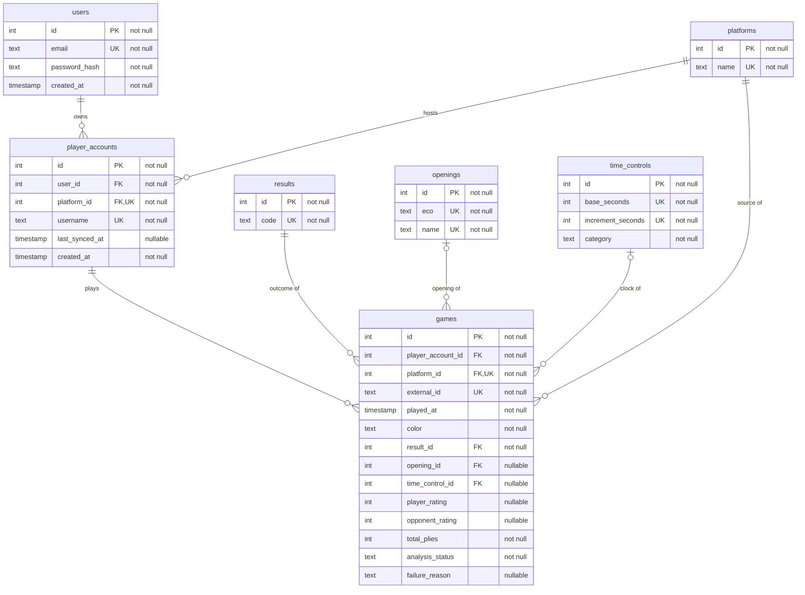
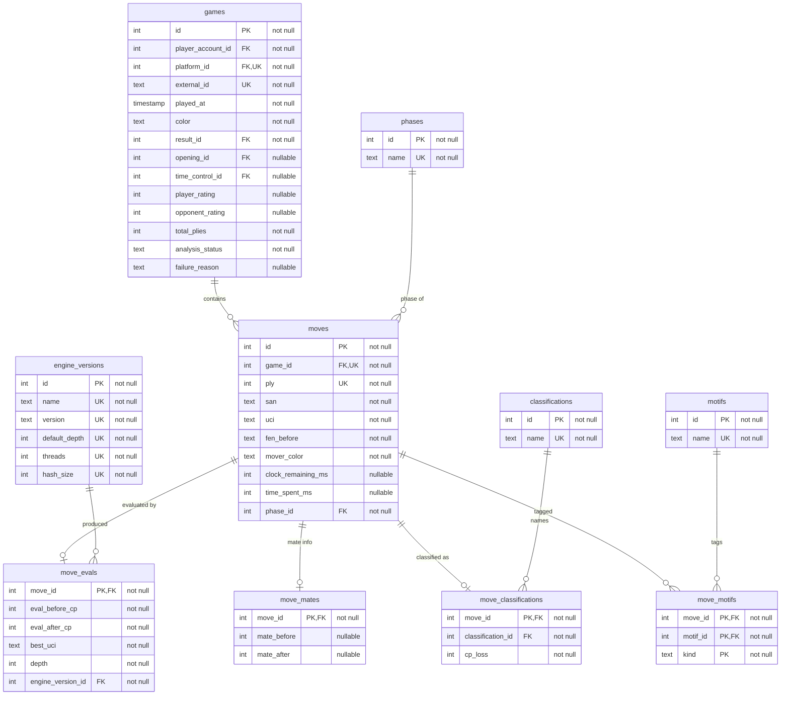
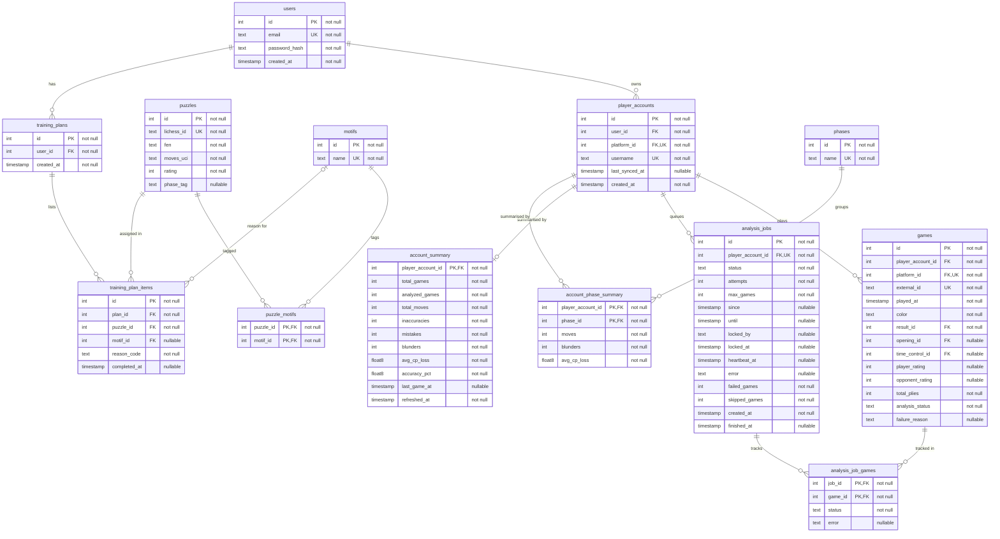

# 2. Entity-relationship diagram

The diagrams below were built from the live database catalog (`information_schema.columns`, `pg_constraint`, `pg_indexes`), not written by hand, so every attribute, type and key matches `DE/schema.sql`. The schema has 24 tables (the Prisma bookkeeping table `_prisma_migrations` is left out), 24 primary keys and 28 foreign keys.

Notation:

- Types: `int` = `integer`, `text` = `text`, `timestamp` = `timestamp(3) without time zone` (all timestamps hold UTC wall-clock time), `float8` = `double precision`.
- `PK` primary key column, `FK` foreign key column, `UK` column that is part of a unique index. The quoted note says whether the column is nullable.
- Crow's foot cardinality: `||--o{` one to zero-or-many, `|o--o{` zero-or-one to zero-or-many (nullable foreign key), `||--o|` one to zero-or-one.

A rendered version of the full diagram is in [`er_diagram.svg`](er_diagram.svg) (rendered with `npx -y @mermaid-js/mermaid-cli -i <file> -o DE/er_diagram.svg`). GitHub also renders the Mermaid blocks below directly.

## 2.1 Full diagram

```mermaid
erDiagram
  users ||--o{ player_accounts : "owns"
  platforms ||--o{ player_accounts : "hosts"
  platforms ||--o{ games : "source of"
  player_accounts ||--o{ games : "plays"
  results ||--o{ games : "outcome of"
  openings |o--o{ games : "opening of"
  time_controls |o--o{ games : "clock of"
  games ||--o{ moves : "contains"
  phases ||--o{ moves : "phase of"
  moves ||--o| move_evals : "evaluated by"
  moves ||--o| move_mates : "mate info"
  moves ||--o| move_classifications : "classified as"
  engine_versions ||--o{ move_evals : "produced"
  classifications ||--o{ move_classifications : "names"
  moves ||--o{ move_motifs : "tagged"
  motifs ||--o{ move_motifs : "tags"
  puzzles ||--o{ puzzle_motifs : "tagged"
  motifs ||--o{ puzzle_motifs : "tags"
  users ||--o{ training_plans : "has"
  training_plans ||--o{ training_plan_items : "lists"
  puzzles ||--o{ training_plan_items : "assigned in"
  motifs |o--o{ training_plan_items : "reason for"
  player_accounts ||--o{ analysis_jobs : "queues"
  analysis_jobs ||--o{ analysis_job_games : "tracks"
  games ||--o{ analysis_job_games : "tracked in"
  player_accounts ||--o| account_summary : "summarised by"
  player_accounts ||--o{ account_phase_summary : "summarised by"
  phases ||--o{ account_phase_summary : "groups"
  account_phase_summary {
    int player_account_id PK, FK "not null"
    int phase_id PK, FK "not null"
    int moves "not null"
    int blunders "not null"
    float8 avg_cp_loss "not null"
  }
  account_summary {
    int player_account_id PK, FK "not null"
    int total_games "not null"
    int analyzed_games "not null"
    int total_moves "not null"
    int inaccuracies "not null"
    int mistakes "not null"
    int blunders "not null"
    float8 avg_cp_loss "not null"
    float8 accuracy_pct "not null"
    timestamp last_game_at "nullable"
    timestamp refreshed_at "not null"
  }
  analysis_job_games {
    int job_id PK, FK "not null"
    int game_id PK, FK "not null"
    text status "not null"
    text error "nullable"
  }
  analysis_jobs {
    int id PK "not null"
    int player_account_id FK, UK "not null"
    text status "not null"
    int attempts "not null"
    int max_games "not null"
    timestamp since "nullable"
    timestamp until "nullable"
    text locked_by "nullable"
    timestamp locked_at "nullable"
    timestamp heartbeat_at "nullable"
    text error "nullable"
    int failed_games "not null"
    int skipped_games "not null"
    timestamp created_at "not null"
    timestamp finished_at "nullable"
  }
  classifications {
    int id PK "not null"
    text name UK "not null"
  }
  engine_versions {
    int id PK "not null"
    text name UK "not null"
    text version UK "not null"
    int default_depth UK "not null"
    int threads UK "not null"
    int hash_size UK "not null"
  }
  games {
    int id PK "not null"
    int player_account_id FK "not null"
    int platform_id FK, UK "not null"
    text external_id UK "not null"
    timestamp played_at "not null"
    text color "not null"
    int result_id FK "not null"
    int opening_id FK "nullable"
    int time_control_id FK "nullable"
    int player_rating "nullable"
    int opponent_rating "nullable"
    int total_plies "not null"
    text analysis_status "not null"
    text failure_reason "nullable"
  }
  motifs {
    int id PK "not null"
    text name UK "not null"
  }
  move_classifications {
    int move_id PK, FK "not null"
    int classification_id FK "not null"
    int cp_loss "not null"
  }
  move_evals {
    int move_id PK, FK "not null"
    int eval_before_cp "not null"
    int eval_after_cp "not null"
    text best_uci "not null"
    int depth "not null"
    int engine_version_id FK "not null"
  }
  move_mates {
    int move_id PK, FK "not null"
    int mate_before "nullable"
    int mate_after "nullable"
  }
  move_motifs {
    int move_id PK, FK "not null"
    int motif_id PK, FK "not null"
    text kind PK "not null"
  }
  moves {
    int id PK "not null"
    int game_id FK, UK "not null"
    int ply UK "not null"
    text san "not null"
    text uci "not null"
    text fen_before "not null"
    text mover_color "not null"
    int clock_remaining_ms "nullable"
    int time_spent_ms "nullable"
    int phase_id FK "not null"
  }
  openings {
    int id PK "not null"
    text eco UK "not null"
    text name UK "not null"
  }
  phases {
    int id PK "not null"
    text name UK "not null"
  }
  platforms {
    int id PK "not null"
    text name UK "not null"
  }
  player_accounts {
    int id PK "not null"
    int user_id FK "not null"
    int platform_id FK, UK "not null"
    text username UK "not null"
    timestamp last_synced_at "nullable"
    timestamp created_at "not null"
  }
  puzzle_motifs {
    int puzzle_id PK, FK "not null"
    int motif_id PK, FK "not null"
  }
  puzzles {
    int id PK "not null"
    text lichess_id UK "not null"
    text fen "not null"
    text moves_uci "not null"
    int rating "not null"
    text phase_tag "nullable"
  }
  results {
    int id PK "not null"
    text code UK "not null"
  }
  time_controls {
    int id PK "not null"
    int base_seconds UK "not null"
    int increment_seconds UK "not null"
    text category "not null"
  }
  training_plan_items {
    int id PK "not null"
    int plan_id FK "not null"
    int puzzle_id FK "not null"
    int motif_id FK "nullable"
    text reason_code "not null"
    timestamp completed_at "nullable"
  }
  training_plans {
    int id PK "not null"
    int user_id FK "not null"
    timestamp created_at "not null"
  }
  users {
    int id PK "not null"
    text email UK "not null"
    text password_hash "not null"
    timestamp created_at "not null"
  }
```



## 2.2 Identity and games

Users link one or more platform accounts. Each game belongs to exactly one account and points to four lookup tables. `opening_id` and `time_control_id` are nullable, so a game can exist without a known opening or clock.



## 2.3 Moves, evaluation and motifs

`moves` is the centre of the analysis data. `move_evals`, `move_classifications` and `move_mates` use `move_id` as both primary key and foreign key, which makes them one-to-one with `moves`. `move_mates` only has a row when a forced mate exists (127 of 7,107 moves in the demo data). `move_motifs` is the link table that resolves the many-to-many relationship between moves and motifs; its key includes `kind` (`allowed` or `missed`), so the same motif can be stored once per kind for one move.



## 2.4 Training, jobs and summaries

`puzzle_motifs` resolves puzzles to motifs (many-to-many). `analysis_job_games` resolves jobs to games (many-to-many: a job analyses many games, and a game can appear in a later job if an earlier one stopped). `account_summary` is one-to-one with `player_accounts`; `account_phase_summary` has one row per account and phase.



## 2.5 Relationships and the foreign keys that implement them

Every row in this table was checked by a script against `pg_constraint` (parent table, child table and column), and the check also confirmed that the 28 rows cover all 28 foreign keys in the database. For the one-to-one rows it confirmed that the foreign key column is the whole primary key of the child table.

| # | Parent (one side) | Child | Cardinality | Relationship type | Foreign key (child column -> parent) | ON DELETE |
|---|---|---|---|---|---|---|
| 1 | `users` | `player_accounts` | 1 to 0..N | one-to-many | `player_accounts_user_id_fkey`: `player_accounts.user_id` -> `users.id` | CASCADE |
| 2 | `platforms` | `player_accounts` | 1 to 0..N | one-to-many | `player_accounts_platform_id_fkey`: `player_accounts.platform_id` -> `platforms.id` | RESTRICT |
| 3 | `platforms` | `games` | 1 to 0..N | one-to-many | `games_platform_id_fkey`: `games.platform_id` -> `platforms.id` | RESTRICT |
| 4 | `player_accounts` | `games` | 1 to 0..N | one-to-many | `games_player_account_id_fkey`: `games.player_account_id` -> `player_accounts.id` | CASCADE |
| 5 | `results` | `games` | 1 to 0..N | one-to-many | `games_result_id_fkey`: `games.result_id` -> `results.id` | RESTRICT |
| 6 | `openings` | `games` | 0..1 to 0..N | one-to-many (optional) | `games_opening_id_fkey`: `games.opening_id` -> `openings.id` | SET NULL |
| 7 | `time_controls` | `games` | 0..1 to 0..N | one-to-many (optional) | `games_time_control_id_fkey`: `games.time_control_id` -> `time_controls.id` | SET NULL |
| 8 | `games` | `moves` | 1 to 0..N | one-to-many | `moves_game_id_fkey`: `moves.game_id` -> `games.id` | CASCADE |
| 9 | `phases` | `moves` | 1 to 0..N | one-to-many | `moves_phase_id_fkey`: `moves.phase_id` -> `phases.id` | RESTRICT |
| 10 | `moves` | `move_evals` | 1 to 0..1 | one-to-one | `move_evals_move_id_fkey`: `move_evals.move_id` -> `moves.id` | CASCADE |
| 11 | `moves` | `move_mates` | 1 to 0..1 | one-to-one (sparse) | `move_mates_move_id_fkey`: `move_mates.move_id` -> `moves.id` | CASCADE |
| 12 | `moves` | `move_classifications` | 1 to 0..1 | one-to-one | `move_classifications_move_id_fkey`: `move_classifications.move_id` -> `moves.id` | CASCADE |
| 13 | `engine_versions` | `move_evals` | 1 to 0..N | one-to-many | `move_evals_engine_version_id_fkey`: `move_evals.engine_version_id` -> `engine_versions.id` | RESTRICT |
| 14 | `classifications` | `move_classifications` | 1 to 0..N | one-to-many | `move_classifications_classification_id_fkey`: `move_classifications.classification_id` -> `classifications.id` | RESTRICT |
| 15 | `moves` | `move_motifs` | 1 to 0..N | many-to-many link (moves side) | `move_motifs_move_id_fkey`: `move_motifs.move_id` -> `moves.id` | CASCADE |
| 16 | `motifs` | `move_motifs` | 1 to 0..N | many-to-many link (motifs side) | `move_motifs_motif_id_fkey`: `move_motifs.motif_id` -> `motifs.id` | RESTRICT |
| 17 | `puzzles` | `puzzle_motifs` | 1 to 0..N | many-to-many link (puzzles side) | `puzzle_motifs_puzzle_id_fkey`: `puzzle_motifs.puzzle_id` -> `puzzles.id` | CASCADE |
| 18 | `motifs` | `puzzle_motifs` | 1 to 0..N | many-to-many link (motifs side) | `puzzle_motifs_motif_id_fkey`: `puzzle_motifs.motif_id` -> `motifs.id` | RESTRICT |
| 19 | `users` | `training_plans` | 1 to 0..N | one-to-many | `training_plans_user_id_fkey`: `training_plans.user_id` -> `users.id` | CASCADE |
| 20 | `training_plans` | `training_plan_items` | 1 to 0..N | one-to-many | `training_plan_items_plan_id_fkey`: `training_plan_items.plan_id` -> `training_plans.id` | CASCADE |
| 21 | `puzzles` | `training_plan_items` | 1 to 0..N | one-to-many | `training_plan_items_puzzle_id_fkey`: `training_plan_items.puzzle_id` -> `puzzles.id` | RESTRICT |
| 22 | `motifs` | `training_plan_items` | 0..1 to 0..N | one-to-many (optional) | `training_plan_items_motif_id_fkey`: `training_plan_items.motif_id` -> `motifs.id` | SET NULL |
| 23 | `player_accounts` | `analysis_jobs` | 1 to 0..N | one-to-many | `analysis_jobs_player_account_id_fkey`: `analysis_jobs.player_account_id` -> `player_accounts.id` | CASCADE |
| 24 | `analysis_jobs` | `analysis_job_games` | 1 to 0..N | many-to-many link (jobs side) | `analysis_job_games_job_id_fkey`: `analysis_job_games.job_id` -> `analysis_jobs.id` | CASCADE |
| 25 | `games` | `analysis_job_games` | 1 to 0..N | many-to-many link (games side) | `analysis_job_games_game_id_fkey`: `analysis_job_games.game_id` -> `games.id` | CASCADE |
| 26 | `player_accounts` | `account_summary` | 1 to 0..1 | one-to-one | `account_summary_player_account_id_fkey`: `account_summary.player_account_id` -> `player_accounts.id` | CASCADE |
| 27 | `player_accounts` | `account_phase_summary` | 1 to 0..N | one-to-many | `account_phase_summary_player_account_id_fkey`: `account_phase_summary.player_account_id` -> `player_accounts.id` | CASCADE |
| 28 | `phases` | `account_phase_summary` | 1 to 0..N | one-to-many | `account_phase_summary_phase_id_fkey`: `account_phase_summary.phase_id` -> `phases.id` | CASCADE |

Many-to-many relationships are implemented as two one-to-many relationships into a link table:

| Many-to-many | Link table | Primary key of the link table |
|---|---|---|
| moves and motifs | `move_motifs` | `(move_id, motif_id, kind)` |
| puzzles and motifs | `puzzle_motifs` | `(puzzle_id, motif_id)` |
| analysis jobs and games | `analysis_job_games` | `(job_id, game_id)` |

## 2.6 Cross-check against psql

Counting the constraint types in the live database:

```
$ docker compose -p pawnprint-demo exec -T db psql -U chess -d chess_analytics -c "SELECT contype, COUNT(*) FROM pg_constraint WHERE connamespace = 'public'::regnamespace AND conrelid::regclass::text <> '_prisma_migrations' GROUP BY contype ORDER BY contype"
 contype | count 
---------+-------
 c       |    37
 f       |    28
 p       |    24
(3 rows)
```

`c` is a CHECK constraint, `f` a foreign key and `p` a primary key. The 37 CHECK constraints come from migration `20261122161952_add_check_constraints` and are listed per table in `04_final_schema.md`; they do not change the diagram, which shows keys and relationships. Unique rules are unique indexes (they appear in `pg_indexes`, see `04_final_schema.md`).

Two examples of `\d` output for the one-to-one and link-table patterns:

```
                  Table "public.move_evals"
      Column       |  Type   | Collation | Nullable | Default 
-------------------+---------+-----------+----------+---------
 move_id           | integer |           | not null | 
 eval_before_cp    | integer |           | not null | 
 eval_after_cp     | integer |           | not null | 
 best_uci          | text    |           | not null | 
 depth             | integer |           | not null | 
 engine_version_id | integer |           | not null | 
Indexes:
    "move_evals_pkey" PRIMARY KEY, btree (move_id)
Foreign-key constraints:
    "move_evals_engine_version_id_fkey" FOREIGN KEY (engine_version_id) REFERENCES engine_versions(id) ON UPDATE CASCADE ON DELETE RESTRICT
    "move_evals_move_id_fkey" FOREIGN KEY (move_id) REFERENCES moves(id) ON UPDATE CASCADE ON DELETE CASCADE

                 Table "public.move_motifs"
  Column  |  Type   | Collation | Nullable |     Default     
----------+---------+-----------+----------+-----------------
 move_id  | integer |           | not null | 
 motif_id | integer |           | not null | 
 kind     | text    |           | not null | 'allowed'::text
Indexes:
    "move_motifs_pkey" PRIMARY KEY, btree (move_id, motif_id, kind)
    "idx_move_motifs_motif_id" btree (motif_id)
Foreign-key constraints:
    "move_motifs_motif_id_fkey" FOREIGN KEY (motif_id) REFERENCES motifs(id) ON UPDATE CASCADE ON DELETE RESTRICT
    "move_motifs_move_id_fkey" FOREIGN KEY (move_id) REFERENCES moves(id) ON UPDATE CASCADE ON DELETE CASCADE
```
