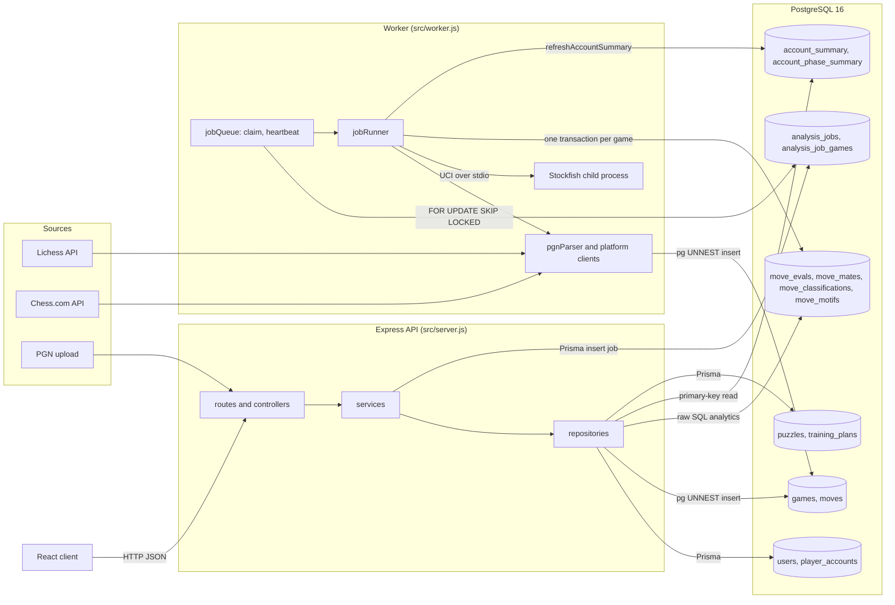

# 8. Architecture and data decisions

## 8.1 Data flow

1. **Sources.** A user links a Lichess or Chess.com account (`POST /accounts`) and asks for an import (`POST /imports`), or uploads a PGN file (`POST /uploads/pgn`).
2. **Parsing.** `src/chess/pgnParser.js` turns PGN text into games: headers, ratings, time control, and for each ply the SAN and UCI move, the FEN before the move, the mover, the clock and the phase (`src/chess/phase.js`). The platform clients (`src/ingest/lichessClient.js`, `chesscomClient.js`) stream games from the public APIs and skip non-standard variants.
3. **Bulk insert.** `insertGameWithMoves` (`src/repositories/moveBulk.repo.js`) writes one game header and all its moves in one transaction: one `INSERT ... ON CONFLICT DO NOTHING` for the game and one `INSERT ... SELECT FROM UNNEST(...)` for the moves.
4. **Job queue.** A job row in `analysis_jobs` (status `queued`) is the unit of work. Platform imports are fetched by the worker inside the job; uploads are inserted by the API and then queued.
5. **Worker with Stockfish.** `node src/worker.js` claims a job with `FOR UPDATE SKIP LOCKED`, refreshes `heartbeat_at` every 25 seconds, and for each pending game runs one persistent Stockfish process (depth 12, 1 thread, 64 MB) over every position (N+1 evaluations for N plies).
6. **Evaluation tables.** `saveGameAnalysis` writes `move_evals`, `move_mates`, `move_classifications` and `move_motifs` for a whole game in one transaction and sets the game to `analyzed`. Per-game progress goes to `analysis_job_games`.
7. **Summaries.** When the job is complete the worker rebuilds `account_summary` and `account_phase_summary`, moves the sync cursor `player_accounts.last_synced_at` forward and runs the data-quality checks (`src/workers/dataQuality.js`).
8. **API and client.** The Express API serves games, analytics (raw SQL over the base tables, or the summary tables for `/analytics/summary`) and training plans; the React client in `client/` calls only `/api/v1/*`.

## 8.2 Why a normalized schema

The analytics questions (blunders by phase, by opening, by clock, by motif, over time) all cut the same move data in different directions. A normalized schema lets each question be one SQL statement over the same tables, with lookups stored once (`03_normalization.md` shows the anomalies of the flat alternative). The two places where we store derived data on purpose, the classification columns and the summary tables, are rebuildable from the base tables and are documented in `03_normalization.md`, section 3.6.

## 8.3 Why a raw `pg` path for bulk inserts

`docs/benchmarks/insert.md` (Apple M4, PostgreSQL 16.15, 1,000 synthetic games of 40 plies):

| Strategy | Moves per second | Speed-up |
|---|---:|---:|
| Prisma `create` per row | 1,587 | 1.0x |
| Prisma `createMany` per game | 10,203 | 6.4x |
| `pg` `INSERT ... SELECT FROM UNNEST(...)` per game (`insertGameWithMoves`) | 13,033 | 8.2x |

A 10,000-game run with the UNNEST path inserted 400,000 moves in 52.92 s (7,559 moves per second). The UNNEST statement sends a game's moves as eight typed arrays in one round trip, inside the same transaction as the game header, so the game and its moves are written together or not at all. Prisma stays in use everywhere else (CRUD, migrations, nested reads such as the game detail).

## 8.4 Why the job queue lives in PostgreSQL

- **No extra infrastructure.** Jobs, games and results are in one database, so creating a job and checking its progress are ordinary queries, and a job's result is committed in the same database as the job's status.
- **Safe concurrent claims.** The claim is one `UPDATE ... WHERE id = (SELECT ... FOR UPDATE SKIP LOCKED LIMIT 1)`. A worker never waits for another worker's locked row and never takes the same job (`tests/claim.concurrency.test.js`: three workers claim 40 jobs with none claimed twice; three workers racing for one job, exactly one gets it). `docs/benchmarks/throughput.md` measured 1, 2 and 3 workers at 33.9, 58.8 and 95.2 plies per second with no failed jobs.
- **Heartbeat and recovery.** A running job whose `heartbeat_at` is older than `JOB_STALE_SECONDS` (120) can be claimed again; `attempts` grows on every claim, and `sweepPoisonJobs` fails a job after 3 attempts. Games already analysed stay `analyzed`, so a reclaimed job continues where the dead worker stopped.
- **One active job per account.** The partial unique index `idx_analysis_jobs_active_unique` allows one `queued` or `running` job per account; `createImportJob` returns the existing active job instead of creating a second one, also when two requests race (it catches the unique violation, error code `P2002`).

## 8.5 Data integrity measures

| Measure | Where |
|---|---|
| Primary key on all 24 tables | `DE/schema.sql` |
| 28 foreign keys; `ON DELETE CASCADE` for ownership, `RESTRICT` for used lookups, `SET NULL` for optional lookups | `02_er_diagram.md`, section 2.5 |
| Unique keys: `users(email)`, `player_accounts(platform_id, username)`, `games(platform_id, external_id)`, `moves(game_id, ply)`, natural keys of all lookups, `puzzles(lichess_id)` | `04_final_schema.md` |
| Partial unique index: one active job per account | `idx_analysis_jobs_active_unique`, query Q16b |
| NOT NULL on every column that must have a value; nullable only where "unknown" is real (`opening_id`, `time_control_id`, ratings, clocks, `last_synced_at`, mate distances) | `04_final_schema.md` |
| One transaction per game for the import and one for the analysis | `insertGameWithMoves`, `saveGameAnalysis`; `tests/moveBulk.test.js` "rollback leaves zero rows when a later step fails" |
| Idempotent imports: `ON CONFLICT (platform_id, external_id) DO NOTHING`, evaluation inserts `ON CONFLICT (move_id) DO NOTHING` | `tests/moveBulk.test.js` "re-inserting the same game is idempotent (isNew false)", "saveGameAnalysis twice creates no duplicates and sets the status"; query Q01 |
| Failed games are kept with a reason, not dropped | `games.analysis_status = 'failed'` with `failure_reason`, `analysis_job_games.error`; `tests/jobRunner.test.js` "fails only the game with an illegal move and completes the job with failedGames 1" |
| Validation before the database: email format and password length (`auth.service.js`), platform and username (`account.service.js`), dates and `since <= until` (`import.service.js`, `analytics.service.js`), integer ids up to 2,147,483,647 (`parseIntId`), PGN file type and 5 MB limit (`uploads.routes.js`) | `tests/auth.test.js`, `tests/accounts.test.js`, `tests/import.service.test.js` "rejects invalid or reversed dates ...", `tests/uploads.test.js` |
| Data-quality checks after every job: `analyzed_games_have_all_evals`, `plies_contiguous`, `every_eval_has_classification`, `eval_ranges`, `mate_rows_consistent`, `failed_games_have_reason`, `no_orphan_progress`, `one_active_job_per_account`, `engine_versions_unreferenced_dupes` | `src/workers/dataQuality.js`, `npm run dq`, `tests/dataQuality.test.js` |

## 8.6 Duplicate, missing and invalid data

- **Duplicates.** The same game imported twice (re-sync, overlapping date range, same PGN uploaded again) hits `games_platform_id_external_id_key` and is skipped; the upload response reports it as `skippedCount`. For uploads without a URL in the `Site` header the external id is a hash of the headers and moves (`computeExternalId`, `src/chess/pgnParser.js`). Linking an already linked platform account returns 409 (`tests/accounts.test.js`). A second import request while a job is active returns the active job.
- **Missing data.** A game without an ECO code or time control is stored with `opening_id` or `time_control_id` NULL; moves without a clock are excluded from the time-pressure buckets and counted as `excludedMoves`; a game without moves is stored but never queued for analysis (`getPendingGameIds` requires `moves: { some: {} }`).
- **Invalid data.** An illegal move stops parsing of that game and sets `parseError`; the game is stored as `failed` with the reason and is never retried (`tests/parser.test.js` "does not throw on illegal moves, yielding moves so far and setting parseError", `tests/import.service.test.js` "a parseError game is stored failed and not returned by getPendingGameIds ..."). Unfinished games (`*`) are rejected with `UNFINISHED_GAME` (`tests/moveBulk.test.js`). Variants and custom start positions are skipped and counted in `skipped_games` (`tests/parser.test.js` "skips variants and custom-FEN games ..."). Engine failures are retried three times on a restarted engine before the job fails (`tests/jobRunner.test.js`).

## 8.7 Indexing strategy and evidence

Indexes follow the access paths, and the write-heavy move tables are kept lean. `games(player_account_id, played_at)` serves the games list (plan E1 in `06_queries.md`: `Index Scan Backward`, 0.118 ms). The analytics queries join the one-to-one tables by `move_id`, their primary key. `player_accounts(user_id)` and `move_motifs(motif_id)` were added after `EXPLAIN (ANALYZE, BUFFERS)` runs at 10,000 games; `docs/explain/README.md` reports that at that size the planner still used sequential scans and the timing changes (-13.7 % to +1.9 %) were within noise, so both are kept for multi-user scale, not for a measured gain. Candidates that were measured and rejected (`move_classifications(classification_id)`, `moves(game_id, mover_color)`, secondary indexes on `move_evals` and `move_mates`) are listed there too. The largest measured read gain comes from the summary tables, not from an index: 0.29 ms against 242.35 ms at 10,000 games (`docs/benchmarks/queries.md`).

## 8.8 Scaling with data volume

- **Growth per game.** In the demo database `moves` takes 1,288 kB, `move_evals` 640 kB and `move_classifications` 520 kB (with indexes) for 7,107 moves, about 350 bytes per move across the three tables (2,506,752 bytes / 7,107 moves; at this small size the figure includes page overhead), or about 31 kB for a game of 89 plies. 10,000 such games would be about 310 MB of move data; the 50,000-row puzzle bank (9 MB) is fixed.
- **Write throughput.** Inserting moves (7,559 to 13,033 per second) is about two orders of magnitude faster than analysing them (33.9 plies per second per worker at depth 12), so the engine is the bottleneck. Throughput grows with the number of workers (2.81x with 3 workers) because claims never block each other.
- **Read path.** Analytics queries aggregate one user's moves; at 10,000 games (200,000 owner moves) they took about 27 to 200 ms at p50 (`docs/benchmarks/queries.md`). The dashboard's summary tiles read the summary tables in under 1 ms at any size, at the cost of a refresh (263 ms at 10,000 games) once per job.
- **Next steps if the data grows much further.** Partition `moves` and the one-to-one tables by `game_id` range (they are always joined through `game_id`, and old partitions could be archived or detached); archive games older than a cut-off into cheaper storage while keeping their summaries; turn the per-request analytics into incremental summaries per account and month; add the missing indexes listed in `04_final_schema.md` (`analysis_job_games(game_id)`, `puzzle_motifs(motif_id)`) when the tables grow.

## 8.9 Honest limits

- The evidence for scale comes from synthetic benchmark data on one laptop (`docs/benchmarks/`), not from production traffic.
- Value columns such as statuses, colours and motif kinds have no `CHECK` constraints; the `(0, 0)` time control has two meanings; `openings` does not enforce one name per ECO code; partial PGN dates fall back to the import time (`03_normalization.md` section 3.7, `07_integration_evidence.md` section 7.4).
- Analytics other than the summary aggregate the base tables on every request, so their cost grows with the number of games of the user.
- Users cannot be deleted through the API, only accounts.
